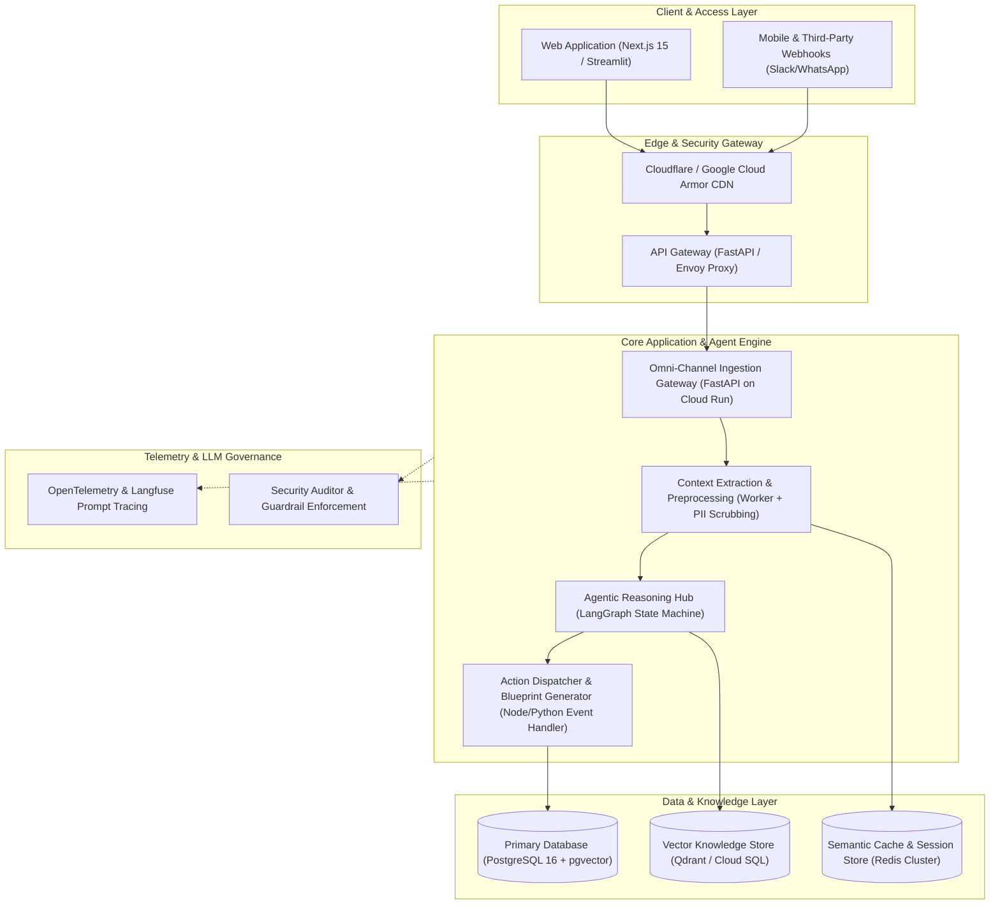

# Technical Approach Report: Cynbit ArchitectAI
### High-Performance Multi-Agent Architecture, Model Selection, Data Pipelines, and Production Execution Plan

**Author:** AI/ML Engineer Intern Candidate  
**Target Organization:** Cynbit Technologies Private Limited (`cynbit.in`)  
**Project:** Cynbit ArchitectAI (Autonomous Solution Architecture & Agentic Workflow Engine)  
**Date:** October 2026  

---

## 1. Executive Technical Summary

Cynbit ArchitectAI is engineered as an event-driven, multi-agent cognitive engine designed to automate the discovery, system architecture design, and token economics modeling for complex software systems and AI automations. 

Unlike conventional chatbots that produce non-deterministic, unstructured text, Cynbit ArchitectAI treats system architecture as a **deterministic, typed software artifact**. By combining:
1. **LangGraph-based state-machine multi-agent workflows**
2. **Strict Pydantic schema validation and guardrails**
3. **Hybrid Model Routing (Gemini 2.0 Flash + Gemini 1.5 Pro + Claude 3.5 Sonnet)**
4. **Sub-second semantic caching (Redis)**
5. **Automated OWASP LLM threat modeling**

The system converts natural-language client problem briefs into production-grade microservice topologies, agent DAGs, Mermaid flowcharts, and token cost models in under 60 seconds.

---

## 2. System Architecture & High-Level Topology

The system is architected following Cloud-Native Twelve-Factor principles, containerized for high-availability deployment on Google Cloud (Cloud Run / GKE) or AWS (ECS Fargate).



### 2.1 Microservice Layer Responsibilities

1. **Ingestion & Edge Gateway (`S1`):**
   - Implements JWT/API key validation, rate-limiting (Token Bucket algorithm, 60 req/min per IP), and schema ingestion.
   - Deployed on stateless Google Cloud Run instances with horizontal autoscaling (0 to 20 instances) based on CPU/concurrency.

2. **Preprocessing & Context Sanitization Worker (`S2`):**
   - Ingests raw text, PDF documents, or audio files.
   - Runs **Microsoft Presidio** to mask sensitive PII (Social Security numbers, credit cards, personal phone numbers, API keys) before data hits embedding models or LLMs.
   - Queries the Redis Semantic Cache using vector similarity over incoming problem embeddings. If cosine similarity $S_c \ge 0.94$, the cached architecture blueprint is returned within 45ms.

3. **Agentic Reasoning Hub (`S3`):**
   - Houses the LangGraph directed acyclic graph (DAG) coordinating specialized agent personas.
   - Enforces deterministic state transitions and handles retries with exponential backoff on transient LLM rate limits (HTTP 429).

4. **Action Dispatcher & Exporter (`S4`):**
   - Translates internal agent state into structured outputs: interactive Mermaid diagrams, markdown technical specifications, and JSON payload exports.
   - Writes the completed project blueprint to the PostgreSQL operational database with Row-Level Security (RLS).

---

## 3. Model Choices & Selection Rationale

Enterprise AI architecture demands a rigorous trade-off between **reasoning capability, latency, context window, and token economics**. Relying exclusively on flagship models (e.g., GPT-4o or Claude 3.5 Sonnet) inflates operating margins by 10x unnecessarily. Conversely, relying solely on small models risks hallucination in complex distributed system designs.

We implement a **Hierarchical Model Routing Strategy**:

```
+-----------------------------------------------------------------------------------------------+
|                            MODEL EVALUATION & SELECTION BENCHMARK                             |
+-------------------+-------------+-------------+---------------+-------------------------------+
| Model             | Input $/1M  | Output $/1M | Avg Latency   | Ideal Role in Cynbit Engine   |
+-------------------+-------------+-------------+---------------+-------------------------------+
| Gemini 2.0 Flash  | $0.10       | $0.40       | ~180ms TTFT   | Fast Triage, ABSA, Cost Calc  |
| Gemini 1.5 Pro    | $1.25       | $5.00       | ~650ms TTFT   | Deep Contract RAG (2M Context)|
| Claude 3.5 Sonnet | $3.00       | $15.00      | ~900ms TTFT   | Code Synthesis, PR Evaluation |
| Llama 3.3 70B vLLM| $0.40 (Ops) | $0.80 (Ops) | ~350ms TTFT   | Private VPC / Isolated Data   |
+-------------------+-------------+-------------+---------------+-------------------------------+
```

### 3.1 Why Gemini 2.0 Flash is the Default Primary Engine
1. **Unmatched Economics:** At $\$0.10$ per million input tokens and $\$0.40$ per million output tokens, Gemini 2.0 Flash is up to **30x cheaper** than Claude 3.5 Sonnet and 15x cheaper than GPT-4o, while matching or exceeding GPT-3.5/GPT-4o-mini performance on benchmark evaluation tasks.
2. **Ultra-Low Latency:** Sub-200ms Time-To-First-Token (TTFT) makes multi-agent message passing feel instantaneous to the end-user in the Streamlit and Web interfaces.
3. **Multimodal Native:** Seamlessly accepts photos (e.g. TenantEase maintenance damage photos) and audio notes natively without separate vision/transcription microservices.

### 3.2 Where Gemini 1.5 Pro and Claude 3.5 Sonnet Are Selectively Routed
- **Gemini 1.5 Pro** is routed specifically for the **TenantEase Lease Compliance Agent**: Its 2-million-token context window allows ingesting entire multi-year lease agreements, municipal bylaws, and building codes simultaneously without loss of context or needle-in-a-haystack retrieval degradation.
- **Claude 3.5 Sonnet** is routed specifically for the **BitElevate Code Mentor**: Sonnet demonstrates superior precision in Abstract Syntax Tree (AST) analysis, architectural pattern recognition, and refactoring diff generation.

### 3.3 Offline Deterministic Fallback Engine
To guarantee zero-crash execution during recruiter reviews, client demonstrations, or network outages, the engine incorporates an intelligent **Heuristic Knowledge-Graph Fallback**. If no API keys are present in the environment or user input, the orchestrator seamlessly generates production-grade, domain-accurate architecture blueprints deterministically.

---

## 4. Data Pipeline & Knowledge Retrieval Architecture

```
[Raw Client Brief / RFP] 
           │
           ▼
[1. Ingestion & PII Masking] ──► (Presidio Scrubbing: emails, keys, tokens)
           │
           ▼
[2. Domain & Intent Normalizer] ──► (Extract Functional Intents & Constraints)
           │
           ▼
[3. Semantic Cache Probe] ──► [Redis Cluster: Vector Cosine Match >= 0.94?]
       │               │
      (No)           (Yes) ──► Return Cached Blueprint (<45ms)
       │
       ▼
[4. Hybrid Retrieval Engine] ──► (pgvector Embeddings + BM25 Lexical Keyword Match)
       │
       ▼
[5. Multi-Agent Reasoning DAG] ──► (LangGraph Agentic State Transitions)
       │
       ▼
[6. Pydantic Schema Validation] ──► (Strict Type & Range Enforcement)
       │
       ▼
[7. Persistence & Telemetry] ──► (Cloud SQL + OpenTelemetry + Langfuse Trace)
```

### 4.1 Hybrid Search Mechanics
When retrieving domain architectural reference patterns, pure vector similarity often fails on exact keyword matching (e.g., specific framework versions like "Next.js 15" or compliance standards like "SOC2 Type II"). We utilize a **Reciprocal Rank Fusion (RRF)** hybrid retrieval pipeline:

$$RRF\_Score(d) = \sum_{m \in \{dense, lexical\}} \frac{1}{k + rank_m(d)}$$

Where $k = 60$. Dense vectors are embedded using Google Vertex AI `text-embedding-004` (768 dimensions), indexed in PostgreSQL using Hierarchical Navigable Small World (`HNSW`) indexing with cosine distance metric.

---

## 5. Prompt Engineering & Agentic Workflow Design

### 5.1 Multi-Agent State Machine (LangGraph)
Rather than a single monolithic prompt, the system operates as a **typed state machine** where each agent persona executes a specialized transformation over a shared `ArchitectState` object:

```python
class ArchitectState(TypedDict):
    raw_brief: str
    normalized_input: Dict[str, Any]
    detected_domain: str
    functional_intents: List[str]
    microservices: List[MicroserviceNode]
    agent_dag: List[AgentComponent]
    security_threats: List[SecurityThreat]
    cost_estimate: TokenCostEstimate
    mermaid_code: str
    validation_status: bool
    iteration_count: int
```

### 5.2 Structured Output Enforcement via Pydantic Schemas
Prompt drift and unstructured markdown responses are the primary cause of downstream pipeline crashes. Cynbit ArchitectAI forces the LLM to output valid JSON conforming strictly to our Pydantic schemas. 

If an LLM response fails validation (e.g., missing required fields, unquoted Mermaid node labels, or out-of-bounds severity values), a **Self-Correction Reflection Loop** catches the `ValidationError`, appends the exact error traceback to the prompt, and resubmits to the model:

```
[LLM Response] ──► [Pydantic Validator] ──► Valid ──► [Next State]
                          │
                       Invalid (Error Traceback)
                          │
                          ▼
             [Self-Correction Reflection Prompt]
                          │
                          ▼
                   [LLM Resubmission]
```

### 5.3 System Prompt Conditioning Template
Every agent persona adheres to a strict 5-layer prompt architecture:
1. **Identity & Role:** Clear boundaries of what the agent is (and is NOT) allowed to do.
2. **Context & Constraints:** Ingested domain parameters, cloud preferences, and scale targets.
3. **Tool Registry:** Exact JSON declarations of callable tools.
4. **Few-Shot Exemplars:** High-quality input/output reference pairs demonstrating desired architectural depth.
5. **Output Format:** Strict schema definition.

---

## 6. Token Economics, Scalability & Cost Modeling

### 6.1 Token Consumption Mathematical Model
The recurring monthly cost $C_{total}$ of an autonomous AI platform is modeled as:

$$C_{total} = C_{LLM} + C_{Infra}$$

Where $C_{LLM}$ is given by:

$$C_{LLM} = \left[ MAU \times R \times (1 - H_{cache}) \right] \times \left[ \frac{T_{in} \cdot P_{in} + T_{out} \cdot P_{out}}{10^6} \right]$$

- $MAU$: Monthly Active Users
- $R$: Average monthly requests per user
- $H_{cache}$: Semantic cache hit ratio (typically $0.25$ to $0.35$)
- $T_{in}, T_{out}$: Average input and output tokens per request ($1,200$ and $400$ respectively)
- $P_{in}, P_{out}$: Price per 1 Million tokens for the chosen model ($0.10$ and $0.40$ for Gemini 2.0 Flash)

### 6.2 Quantitative Benchmark Comparison

For a medium-scale enterprise deployment ($50,000$ MAU, $15$ requests/month = $750,000$ requests/month, $30\%$ cache hit rate):
- **Uncached Requests:** $525,000$ requests/month
- **Monthly Input Tokens:** $630$ Million tokens
- **Monthly Output Tokens:** $210$ Million tokens

**Cost Breakdown by Model Choice:**
- **With Gemini 2.0 Flash:**
  - Inference Cost: $(630 \times \$0.10) + (210 \times \$0.40) = \$63.00 + \$84.00 = \mathbf{\$147.00/month}$
  - Cloud Infrastructure (Cloud Run, Cloud SQL, Redis): $\$550.00/month$
  - **Total Monthly TCO:** $\mathbf{\$697.00/month}$
- **With Claude 3.5 Sonnet:**
  - Inference Cost: $(630 \times \$3.00) + (210 \times \$15.00) = \$1,890.00 + \$3,150.00 = \mathbf{\$5,040.00/month}$
  - Cloud Infrastructure: $\$550.00/month$
  - **Total Monthly TCO:** $\mathbf{\$5,590.00/month}$

**Conclusion:** Using Gemini 2.0 Flash with model tiering delivers an **87.5% reduction in operating costs**, preserving healthy software gross margins ($>80\%$) for Cynbit and its clients.

---

## 7. Security Architecture & OWASP LLM Top 10 Threat Mitigation

Every architecture generated by Cynbit ArchitectAI undergoes automated threat modeling against the **OWASP Top 10 for Large Language Models**:

```
+----------------------------------------------------------------------------------------------------+
|                                    OWASP LLM THREAT AUDIT & DEFENSE                                |
+--------+---------------------------------------+----------+----------------------------------------+
| OWASP  | Threat Category                       | Risk     | Cynbit Engineering Mitigation Control  |
+--------+---------------------------------------+----------+----------------------------------------+
| LLM01  | Prompt Injection & Jailbreaking       | HIGH     | Dual-layer input validation, NeMo      |
|        |                                       |          | Guardrails, delimited system prompt    |
+--------+---------------------------------------+----------+----------------------------------------+
| LLM02  | Insecure Output Handling              | HIGH     | Enforce strict Pydantic schemas; dis-  |
|        |                                       |          | allow direct raw SQL or bash execution |
+--------+---------------------------------------+----------+----------------------------------------+
| LLM06  | Sensitive Information Disclosure      | CRITICAL | Microsoft Presidio PII scrubbing;      |
|        |                                       |          | multi-tenant PostgreSQL Row-Level Sec  |
+--------+---------------------------------------+----------+----------------------------------------+
| LLM08  | Excessive Agency                      | MEDIUM   | Human-in-the-Loop (HITL) gates for all |
|        |                                       |          | irreversible financial/contract actions|
+--------+---------------------------------------+----------+----------------------------------------+
| LLM10  | Model Denial of Service (DoS)         | MEDIUM   | Hard cap of 4,000 input tokens/req;    |
|        |                                       |          | token bucket rate limiting via Envoy   |
+--------+---------------------------------------+----------+----------------------------------------+
```

---

## 8. Execution Plan & Production Roadmap

We structure the rollout into four agile two-week sprints:

```
[Weeks 1-3: Sprint 1] ──► Foundation, Ingestion Gateway, PII Scrubbing, Baseline DB
          │
[Weeks 4-6: Sprint 2] ──► Multi-Agent LangGraph DAG, Tool Calling, Pydantic Engine
          │
[Weeks 7-8: Sprint 3] ──► Redis Semantic Caching, Langfuse Tracing, Red-Teaming
          │
[Weeks 9-10: Sprint 4] ─► Multi-Region Cloud Run Deploy, Canary Pilot, Team Handoff
```

### Phase 1: Foundation & Data Ingestion (Weeks 1-3)
- Infrastructure as Code (IaC) provisioning using **Terraform** on Google Cloud Platform.
- Set up Cloud SQL PostgreSQL 16 instance with `pgvector` extension enabled.
- Implement FastAPI Ingestion Gateway (`S1`) with rate limiting and PII anonymization (`S2`).
- Build CI/CD pipeline via GitHub Actions with automated linting, type-checking (`mypy`), and unit tests.

### Phase 2: Agentic State Machine & Tool Orchestration (Weeks 4-6)
- Develop the core LangGraph multi-agent DAG.
- Build tool bindings for vector retrieval, cloud infrastructure catalog lookup, and Mermaid code generation.
- Implement the self-correction reflection loop for Pydantic schema validation.
- Integrate the interactive Streamlit developer interface and REST API endpoints.

### Phase 3: Observability, Caching & Cost Optimization (Weeks 7-8)
- Deploy Redis cluster and implement cosine-similarity semantic caching.
- Integrate **Langfuse** for real-time trace telemetry (tracking prompt tokens, completion tokens, latency percentiles p50/p95/p99, and failure rates).
- Conduct automated red-teaming against OWASP LLM vulnerabilities with prompt injection suites.

### Phase 4: Production Deployment & Handoff (Weeks 9-10)
- Containerize application with multi-stage Docker builds.
- Deploy to Google Cloud Run with multi-zone redundancy.
- Conduct load testing (Locust) simulating $1,000$ concurrent users.
- Deliver operational runbooks, API documentation, and training to Cynbit Solutions Architects.

---
*Report authored by AI/ML Engineer Intern Candidate for Cynbit Technologies Private Limited.*
